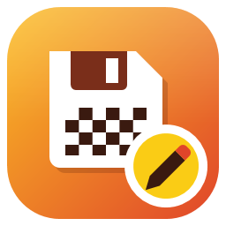

# NFSMW Save Tool

<p align="center"></p>

> [!IMPORTANT]
> **Before you use it, back up your saves: close the game and copy the whole
> `NFS Most Wanted` folder (in your Documents) somewhere else - a USB stick, the cloud.**
>
> **The tool also backs up by itself, before EVERY change:** a full copy of the profile folder
> goes to `Documents\NFS Most Wanted - backups\<Profile>_<date>_<time>`, next to the saves
> folder (never inside it, so the game does not see it). Older copies are never overwritten.
> If the copy fails, nothing is changed.
>
> **To restore** (game closed): move the profile's current folder out of `NFS Most Wanted`,
> copy the backup folder in, and rename it back to just `<Profile>` (drop the `_<date>_<time>`
> part). Restoring your own copy works the same way: copy it back with the game closed.

Rename a **Need for Speed: Most Wanted (2005)** save profile without corrupting it.

Renaming the save folder and the file inside it does **not** change the name the game
shows. The player name is stored inside the save. And every attempt to hex-edit it
tends to end the same way: the game refuses to load the profile.

There is a reason for that, and it is not documented anywhere obvious.

> Just want to fix your save? Read **`READ-ME-FIRST.txt`** — same thing in plain text,
> opens in Notepad. This README has the format details.

## The reason

The save ends with an MD5 of its own body:

```
MD5( bytes[0x34 : filesize - 16] )  ==  the last 16 bytes of the file
```

Change a single byte and that hash no longer matches, so the game rejects the file.
Recompute it and the same edit is accepted. That is the whole trick.

## Save format (the parts that matter)

Verified against four saves from the same installation, all 63,596 bytes:

| offset | size | meaning |
|---|---|---|
| `0x0000` | 4 | magic, `"20CM"` |
| `0x0004` | 4 | total file size (uint32, little-endian) |
| `0x000C` | 4 | body size |
| `0x0010` | 4 | CRC32 of `bytes[0x1C : 0x24]` |
| `0x0014` | 4 | CRC32 of `bytes[0x24 : filesize]` (covers the name and the MD5) |
| `0x0018` | 4 | CRC32 of `bytes[0x00 : 0x18]` (the header itself) |
| `0x0034` | — | start of the checksummed region |
| `0x5A31` | 36 | player name: ASCII, NUL-terminated, **fixed-width field** |
| `filesize-16` | 16 | MD5 of `bytes[0x34 : filesize-16]` |

The name field is fixed width, so a shorter or longer name never shifts anything
after it. Names up to **35 characters** are safe. ASCII only.

The three CRC32s use polynomial `0x04C11DB7`, not reflected, with the first 4 bytes inverted, and
are stored little-endian. The game does not seem to check them: on the installation this was
tested on, it loaded a renamed save whose `0x0014` CRC had been left stale. The tool rewrites all
three after every change anyway, so the whole file stays consistent.

Saves live in your Documents folder:

```
<Documents>\NFS Most Wanted\<Profile>\<Profile>
```

If OneDrive backs up your Documents, or you moved it, that is not
`%USERPROFILE%\Documents`. Both the window and `nfsmw_save.py` ask Windows where it is.

The folder and the file inside share the same name, and the game needs both to match.
A folder whose inner file has a different name is simply ignored.

## Usage

### Window (no Python needed)

Downloaded from GitHub? Click the green **Code** button > **Download ZIP**, right-click the ZIP >
**Extract All**, open the extracted folder (inside it there is another one with the same name: open
that one too), and only then double-click `ABRIR.bat`. Don't run it from inside the ZIP, and don't
copy only the `.bat` somewhere else.

Double-click **`ABRIR.bat`**, or run `NFSMW-Save-Tool.ps1`. Lists every profile with the
name stored inside and whether the checksum is valid; pick one, type the new name, click
**Renomear**. Pure PowerShell + WPF, nothing to install. **Close the game before renaming**
(if it is open, the window says so and changes nothing).

Before the first change each time it opens, the window asks once: it shows where the backup
copy goes, recommends copying the whole saves folder yourself, and has **Abrir a pasta de
saves** (opens the saves folder), **Continuar** and **Cancelar** (changes nothing). After each
change, the log at the bottom says where that change's copy is.

If Windows shows **"Windows protected your PC"**, click **More info** > **Run anyway**; if it shows
**"Security Warning"**, click **Run**. That happens because the file came from the internet; the
program is plain text, so you can read all of it first.

If it still does not open: on school or work PCs, or with **Smart App Control** turned on, Windows
blocks scripts downloaded from the internet. The black window says why; on that PC only whoever
manages it can allow it.

### Command line

```bash
# see every profile, the name stored inside it, and whether the checksum is valid
python nfsmw_save.py list

# inspect one file
python nfsmw_save.py check "C:\Users\you\Documents\NFS Most Wanted\Racer\Racer"

# change the in-game name (makes a full backup copy of the profile first)
python nfsmw_save.py rename Racer NewName

# ...and also rename the folder and file to match
python nfsmw_save.py rename Racer NewName --also-rename-folder
```

The tool refuses to touch a save whose checksum is already broken, makes a full copy of
the profile folder before every change (and a `.bak` next to the save before the first
one), and verifies the result by reading the file back from disk rather than trusting what
it just wrote.

The command line asks nothing (it is meant for people who type commands): it makes the same
full copy before every change, prints its path, and changes nothing if the copy fails. Close the
game first here too: if it is running, it stops and changes nothing.

## How this was found

Three saves from one installation, all exactly 63,596 bytes, with different profile
names. That made it possible to compare instead of guess:

1. Searching each file for its own profile name found a hit at the same offset
   (`0x5A31`) in two of them, and **no hit** in the third. That third save was the
   one whose folder had been renamed by hand: the folder said one name, the bytes
   inside still said the old one. That alone explained the original symptom.

2. Counting the zero padding after the name showed the next record starting at the
   same offset in every save, regardless of name length. Fixed-width field.

3. The header held two 16-byte blocks that looked like hashes. Testing MD5 over
   candidate ranges found the match on the first try:
   `MD5(body from 0x34 to filesize-16)` equals the final 16 bytes.

4. That rule was then checked against all three saves before being trusted. Three
   out of three.

Step 4 is the point. One match could be coincidence; three is a format.

## Caveats

- Verified on the PC release, save files of 63,596 bytes. Other builds may differ —
  in the window, look at the **Integro** column (`sim` means the checksum is valid; on the
  command line, run `check`) *before* trusting the rename. If it shows **outro formato**
  (another layout; the command line says `unknown layout`), the name is not where this tool
  expects it and the tool refuses to change that save.
- This edits only the name field and the checksums (the trailing MD5 and the three header
  CRC32s). It does not touch
  progress, cars, or anything else.
- Not affiliated with EA or the game in any way.

## Appearance

The window follows your Windows theme (light or dark). The **Aparência** button (top right) lets you
pick one of 6 themes, the accent color, the size (zoom), the font and the corners. Changes apply
instantly and are saved to `aparencia.json` next to the program.

## Licence

MIT - see the `LICENSE` file. In plain words: you can use, copy, modify and share it, even in
other projects, as long as you keep the copyright notice. No warranty.
